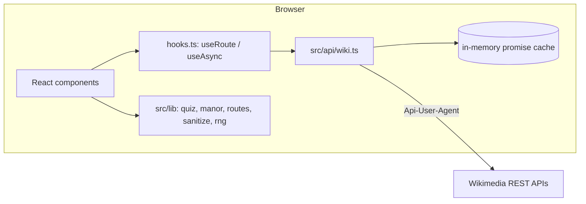
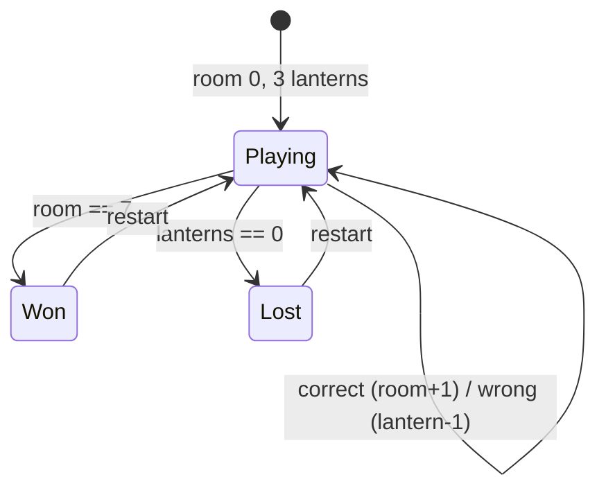

# Design: Grimoire '95

## Overview
A static single-page React app. The browser talks directly to public Wikimedia REST APIs. All logic that can be pure lives in `src/lib` and is covered by property-based tests; React components only wire data to views.

## Routing
Hash routes keep static hosting simple and survive any base path:

| Route | View |
| --- | --- |
| `#/` | `Home` |
| `#/article/<Canonical_Title>` | `ArticleView` |
| `#/manor` | `MindManor` |
| anything else | not-found panel |

`useRoute()` subscribes to `hashchange` through `useSyncExternalStore`. `articleHref()` and `parseHash()` round-trip any title (property tested).

## Data layer (`src/api/wiki.ts`)
| Function | Endpoint | Used by |
| --- | --- | --- |
| `getFeatured(date)` | `en …/rest_v1/feed/featured/YYYY/MM/DD` | Home |
| `getSummary(title, lang)` | `…/rest_v1/page/summary/{title}` | ArticleView |
| `getArticleHtml(title, lang)` | `…/rest_v1/page/html/{title}` (Parsoid) | ArticleView |
| `getMedia(title, lang)` | `…/rest_v1/page/media-list/{title}` | MediaGallery |
| `getRandomTitle(lang)` | `…/rest_v1/page/random/summary` | Random button |
| `searchTitles(q, lang)` | `…/w/rest.php/v1/search/title` | SearchBox |
| `getOnThisDay(m, d)` | `en …/rest_v1/feed/onthisday/events/MM/DD` | MindManor |

- Raw responses are mapped to small app types (`PageSummary`, `SearchHit`, `MediaItem`, `QuizEvent`) at the boundary.
- Successful results are memoized per session; failures are evicted so retry works.
- Errors carry the HTTP status (`WikiError`) so the UI can tell "missing" (404) from "offline".

## Article pipeline (`src/lib/sanitize.ts`)
1. Parse the Parsoid document with `DOMParser` (inert: no scripts run, no images load).
2. Strip site chrome (references, navboxes, banners, edit links) and reference-only sections.
3. Unwrap links around images; rewrite `./Title` links with `wikiHrefToRoute()`; send namespaced and external links to Wikipedia/the web.
4. Absolutize protocol-relative image URLs; prefix every `id` with `g-` to avoid DOM clobbering.
5. Collect `h2` headings for the table of contents.
6. **Last step:** DOMPurify with an allow-list of URI schemes (`https?://`, `#/article/`). A DOMPurify hook adds `target`/`rel` to external links and `loading="lazy"` to images.

## Mind Manor
### Riddle generation (`src/lib/quiz.ts`)
Input: today's "on this day" events (≈60–150 per day), each with linked page summaries.

- **Year riddle:** event text with the year redacted; options are the real year plus 3 decoys from a window that widens with the event's age (±5 to ±300 years), excluding year 0 and future years.
- **Identity riddle:** a page extract with the title and its 4+ letter words redacted; options are the real title plus 3 other page titles from the same day (case-insensitively distinct).
- Kinds alternate year → identity → year…, falling back to whichever kind still has material.
- All randomness comes from an injected seeded `Rng`, so a seed fully determines a game.

### Game state (`src/lib/manor.ts`)

`QUESTIONS_NEEDED = LAST_ROOM + MAX_LANTERNS - 1 = 9` is the most riddles any game can consume.

## Correctness properties (fast-check)
| # | Property | Validates |
| --- | --- | --- |
| P1 | `shuffle` returns a permutation of its input | 5.10 |
| P2 | `yearOptions` returns 4 distinct integers containing the real year once, none 0, none > max year | 5.6, 5.7 |
| P3 | Year labels (`formatYear`) are distinct | 5.6 |
| P4 | `redact` output never contains the title or any 4+ letter title word (any case) | 5.8 |
| P5 | Every generated riddle has 4 case-insensitively distinct options and a valid answer index | 5.6 |
| P6 | Identity clues and hints never contain the answer; year clues never contain the answer year | 5.7, 5.8 |
| P7 | With ≥ 12 events, `buildQuestions` fills all 9 slots | 5.5 |
| P8 | `buildQuestions` is deterministic per seed | 5.10 |
| P9 | Manor invariants after any action sequence: 0 ≤ lanterns ≤ 3, 0 ≤ room ≤ 7, won ⇔ attic, lost ⇔ no lanterns, score = room | 5.1–5.4 |
| P10 | Terminal states ignore further answers; any 9 answers end the game | 5.4, 5.5 |
| P11 | `articleHref` ∘ `parseHash` and `wikiHrefToRoute` ∘ `parseHash` round-trip any title | 3.3 |
| P12 | For arbitrary hostile/benign HTML mixes, sanitized output has no script/iframe/form/style, no `on*` attributes, and only safe hrefs | 3.4 |

## Error handling
- Network failure → `ErrorPanel` with retry (Home, ArticleView, MindManor).
- 404 in Simple mode → explain and offer the full article.
- Not enough events for 9 riddles → "spirits ran out of riddles" panel with restart.

## Visual design
- Desktop: dithered night-purple background with drifting fog; one app window with a violet → pumpkin title bar, beveled toolbar and status bar.
- Pages: parchment panels, serif body text, violet section headers.
- Ghost mascot built with pure CSS (floats and blinks); disabled under reduced motion.
